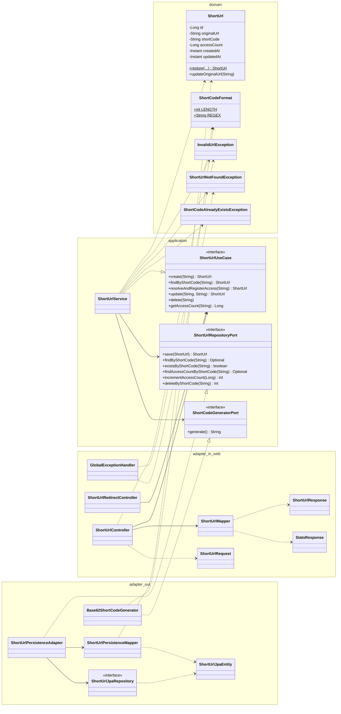

# 🔗 Shortify API

API RESTful de encurtamento de URLs, com CRUD completo e estatísticas de acesso.

## ✨ Funcionalidades

- Criar uma short URL a partir de uma URL longa
- Consultar os dados de uma short URL
- Redirecionar para a URL original (registrando o acesso)
- Atualizar a URL original de um código existente
- Remover uma short URL
- Consultar estatísticas de acesso (número de vezes que foi acessada)
- Documentação interativa (Swagger UI / OpenAPI) e endpoints operacionais (Actuator)

## 🧱 Arquitetura

O projeto segue **arquitetura hexagonal (ports & adapters)**, isolando as regras de negócio de frameworks e infraestrutura.
A regra de dependência aponta sempre para dentro: **adapters → application → domain**.

```
domain/
  model/            → ShortUrl (modelo de domínio puro), ShortCodeFormat
  exception/        → InvalidUrlException, ShortUrlNotFoundException, ShortCodeAlreadyExistsException

application/
  port/in/          → ShortUrlUseCase (casos de uso)
  port/out/         → ShortUrlRepositoryPort, ShortCodeGeneratorPort
  service/          → ShortUrlService (implementa os casos de uso)

adapter/
  in/web/           → controllers, DTOs, mapper e GlobalExceptionHandler
  out/persistence/  → ShortUrlPersistenceAdapter, entidade JPA, repositório Spring Data, mapper
  out/codegen/      → Base62ShortCodeGenerator

config/             → OpenApiConfig
```

### Diagrama de classes



## 🛠️ Stack

- Java 21
- Spring Boot 4.1.2 (Web, Validation, Data JPA, Actuator)
- MySQL
- Liquibase (versionamento de schema)
- springdoc-openapi 3.2.0 (OpenAPI / Swagger UI)
- JUnit 5 + Mockito
- Testcontainers (MySQL) para testes de integração
- JaCoCo (cobertura)

## 📡 Endpoints

### API

| Método | Rota | Descrição | Respostas |
|---|---|---|---|
| POST | `/api/shorten` | Cria uma short URL (body `{"url": "..."}`) | `201`, `400` |
| GET | `/api/shorten/{code}` | Retorna os dados da short URL | `200`, `404` |
| PUT | `/api/shorten/{code}` | Atualiza a URL original (body `{"url": "..."}`) | `200`, `400`, `404` |
| DELETE | `/api/shorten/{code}` | Remove a short URL | `204`, `404` |
| GET | `/api/shorten/{code}/stats` | Retorna as estatísticas de acesso | `200`, `404` |
| GET | `/{code}` | Redireciona (`302`, header `Location`) para a URL original e incrementa o contador de acessos | `302`, `404` |

Regras: `{code}` tem **7 caracteres alfanuméricos** (Base62); a URL deve ser `http` ou `https` e ter no máximo **2048 caracteres**.
Os erros seguem o formato `application/problem+json` (`ProblemDetail`) com `timestamp` e, em erros de validação, a lista `errors[]` (`field` e `message`).

### Documentação

| Método | Rota | Descrição |
|---|---|---|
| GET | `/swagger-ui/index.html` | Swagger UI |
| GET | `/v3/api-docs` | Especificação OpenAPI (JSON) |

### Operação (Actuator)

| Método | Rota | Descrição |
|---|---|---|
| GET | `/actuator/health` | Saúde da aplicação (inclui o banco) |
| GET | `/actuator/health/liveness` | Probe de liveness |
| GET | `/actuator/health/readiness` | Probe de readiness |
| GET | `/actuator/info` | Informações da aplicação |
| GET | `/actuator/metrics` | Métricas |

Somente `health`, `info` e `metrics` são expostos; os detalhes do health ficam ocultos (`show-details: never`).

### Exemplo

```bash
curl -X POST http://localhost:8080/api/shorten \
  -H "Content-Type: application/json" \
  -d '{"url": "https://example.com/um/caminho/bem/longo"}'
```

```json
{
  "id": 1,
  "url": "https://example.com/um/caminho/bem/longo",
  "shortCode": "aB3dE9x",
  "shortUrl": "http://localhost:8080/aB3dE9x",
  "createdAt": "2026-10-25T12:00:00Z",
  "updatedAt": "2026-10-25T12:00:00Z"
}
```

## 🚀 Como executar

Pré-requisitos: Java 21 e um MySQL acessível em `localhost:3306`, com o banco `shortifyapiDb` e o usuário `root` sem senha
(valores padrão de `src/main/resources/application.yaml`; ajuste conforme seu ambiente).

```bash
./mvnw spring-boot:run
```

As migrations do Liquibase são executadas automaticamente na inicialização.
Com a aplicação no ar, abra a Swagger UI em <http://localhost:8080/swagger-ui/index.html> e o health em <http://localhost:8080/actuator/health>.

## 🧪 Testes

Os testes de integração usam Testcontainers, então é necessário ter o **Docker** em execução.

```bash
./mvnw test
```

Um único container MySQL é compartilhado por todas as classes de integração (`support/IntegrationTestSupport`) e pode ser
reaproveitado entre execuções com `testcontainers.reuse.enable=true` em `~/.testcontainers.properties`.
O relatório de cobertura do JaCoCo é gerado em `target/site/jacoco` (com `./mvnw verify`).
